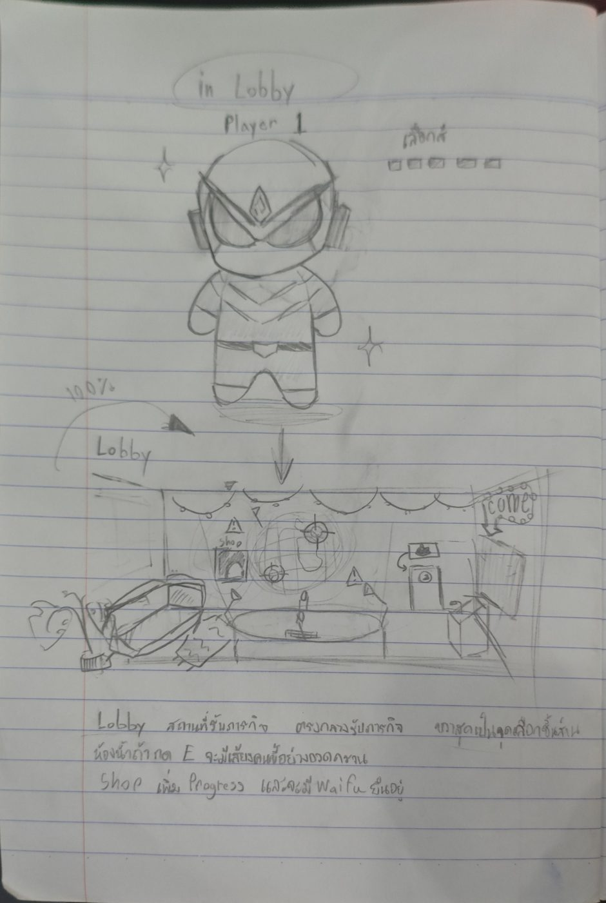
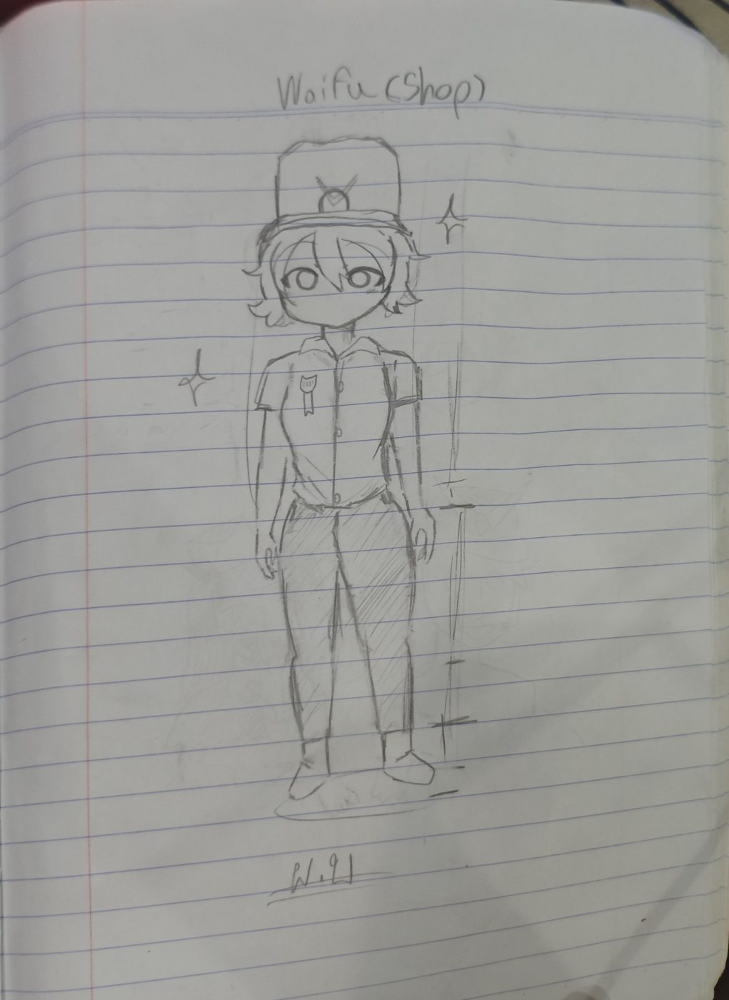
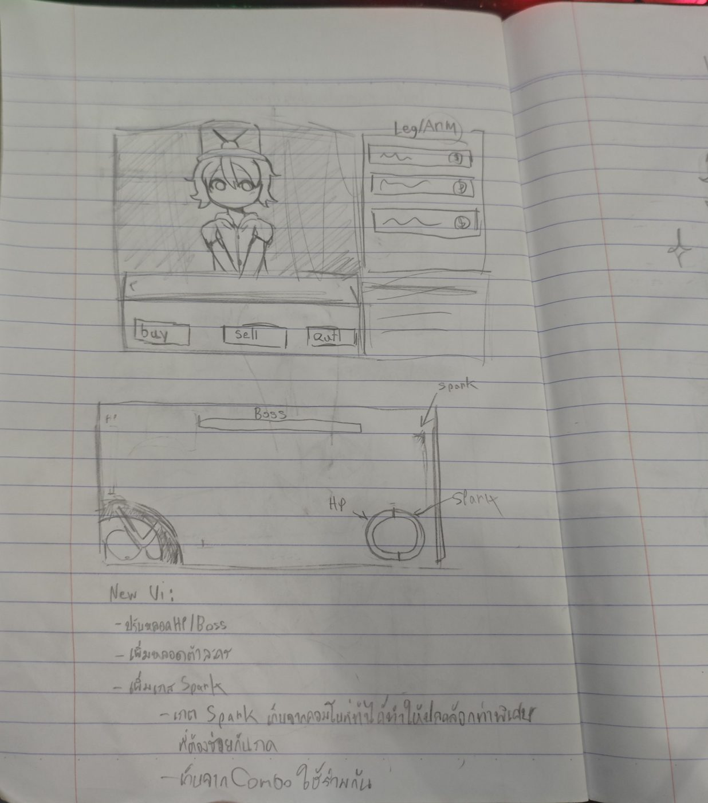
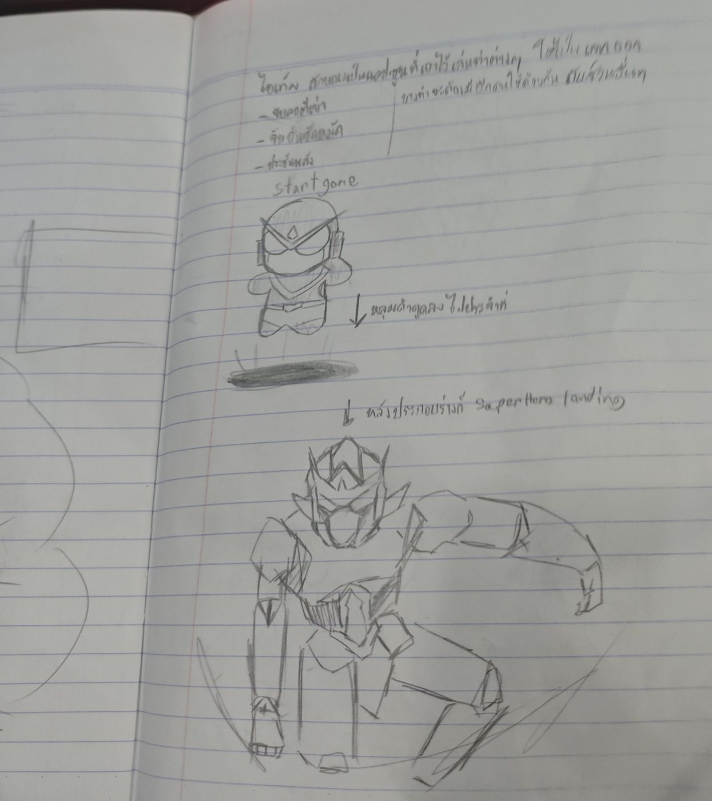
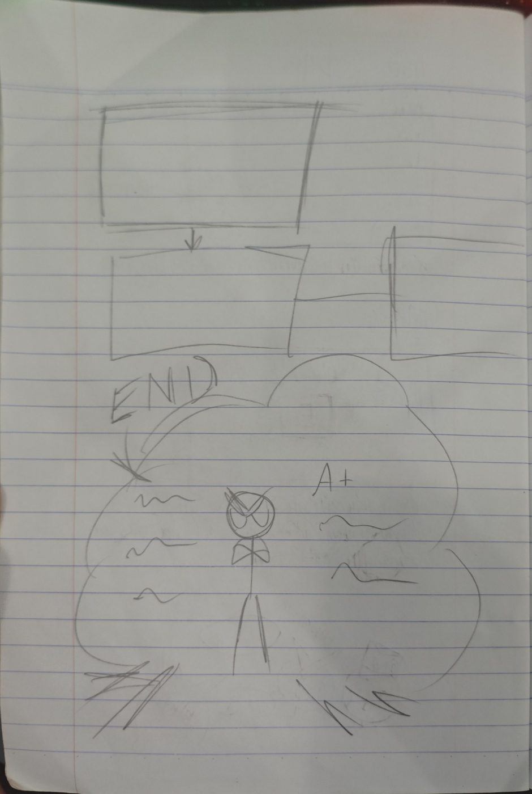
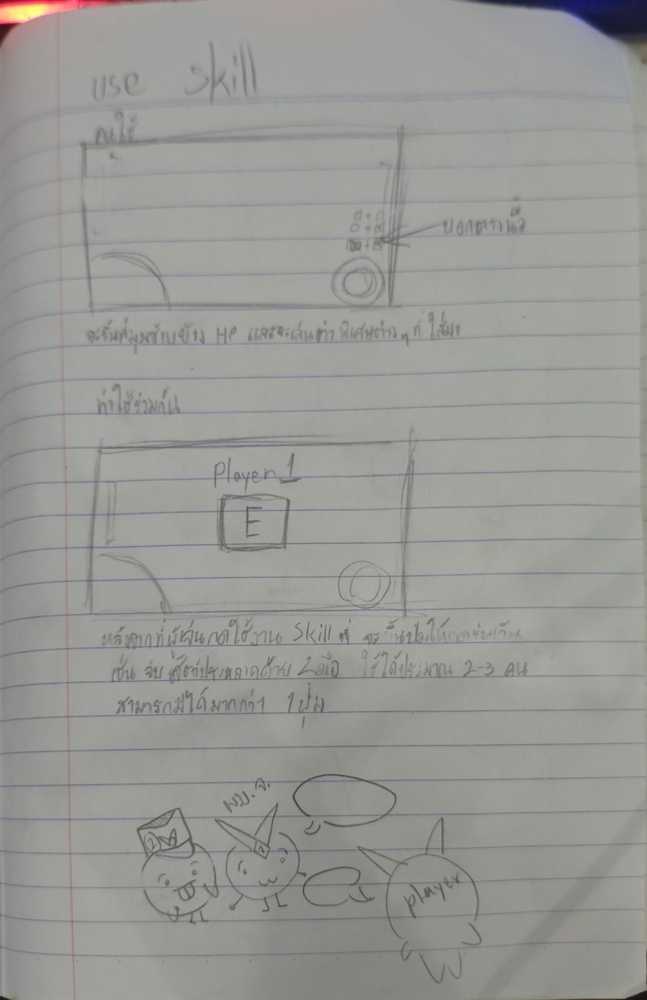
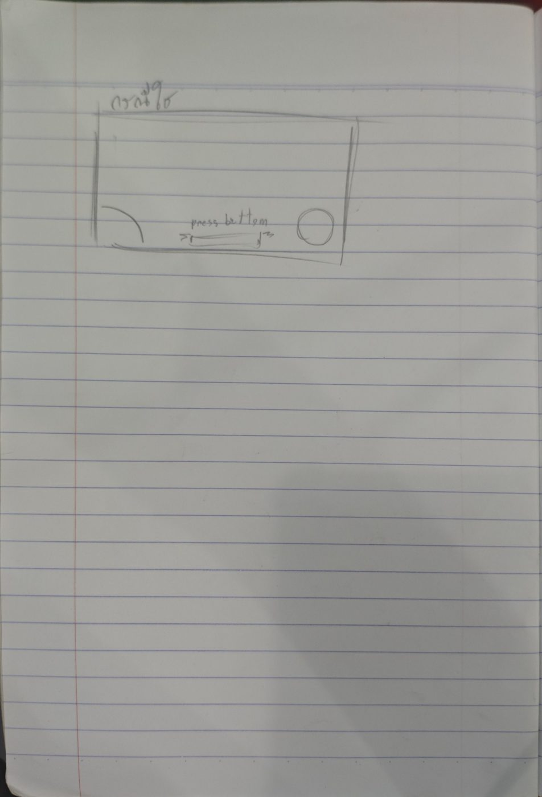

# ไอเดียเกม 4 คน 1 หุ่น — ท่าร่วม Spark ร้าน ล็อบบี้

ไอเดียจากสมุดผู้ใช้ 2026-11-13 ที่ตกลงแล้ว ภาพต้นฉบับอยู่ใน [sketches/2026-11-13/](sketches/2026-11-13/)
ทิศทางรวมของเกมอยู่ที่ [Game-Design.md](Game-Design.md) งานที่แตกออกมาเป็นเควส `Q-20261113-*` ใน [quests/](quests/)

## เป้าหมาย

- เพิ่มการสื่อสารในทีม
- เพิ่มลูปที่เล่นซ้ำได้
- ทำให้เกมมีความคืบหน้า (progress) จากร้าน

## ไอเดีย

- **ท่าพิเศษแบบสุ่ม:** ตีโดนแล้วมีโอกาสได้ท่าที่ผูกกับชิ้นส่วน เช่น จับคอตีเข่า = แขน 2 + ขา 1 คนคุมชิ้นเหล่านั้นเห็นปุ่มแล้วต้องกดพร้อมกัน ไม่ครบ = ไม่ออก ไม่มีบทลงโทษ (ทีมต้องบอกจังหวะกันเอง)
- **อัตราออกท่า:** เริ่ม 5% เพิ่ม 2.5% ทุกครั้งที่ตีโดน ออกแล้วรีเซ็ต พัก 10 วินาทีหลังท่า (ปรับได้) สุ่มเฉพาะท่าที่ชิ้นที่ต้องใช้ยังติดตัวและบอสอยู่ในระยะ
- **ช่องท่า:** คนละ 3 ช่อง ท่าร่วมขอแค่คนในกลุ่มชิ้นนั้นใส่ 1 คน ใส่ 2 คนแล้วกดพร้อมกัน = เวอร์ชันแรงกว่า
- **Spark = อัลติ:** หลอดร่วมทั้งทีม เติมจากคอมโบ เต็มแล้วกดใช้ ข้างในเป็น QTE ล้วน ดาเมจแรง พลาด QTE ลดดาเมจ ใช้ทั้งโหมดบอสและ PVP (PVP ทีมละหลอด)
- **หน้าจบเกม:** END + เกรด นับจากจำนวนคอมโบ ได้เงินตามเกรด
- **ร้าน:** waifu 2D แบบง่าย ขาย moveset ไม่ใช่อาวุธ (ขายสีหุ่นด้วยไหม ยังไม่ตัดสิน)
- **ล็อบบี้โรงเก็บหุ่น:** ตามแมพที่ออกแบบไว้ เลือกสี, ลูกโลกกด E เลือกด่าน, ร้าน แล้วประกอบร่าง + superhero landing
- **ด่าน:** เพิ่มจากลูกโลก (ทางที่ถูกที่สุด: บอสเดิม + เงื่อนไขพิเศษ ยากขึ้นได้เงินมากขึ้น)
- **HUD ใหม่:** แถบบอสบน วง HP + วง Spark ขวาล่าง รูปตัวละครซ้ายล่าง ปุ่มคำสั่งท่าข้างวง HP

## ลำดับทำ

1. ท่าสุ่ม + ท่าแรก จับคอตีเข่า
2. Spark + อัลติ QTE + HUD วง
3. หน้าจบเกม เกรด + เงิน
4. ร้าน + จัดช่องท่า
5. ล็อบบี้ + landing

## ภาพจากสมุด

**1. ล็อบบี้:** นักบิน Player 1 เลือกสี โรงเก็บหุ่น ลูกโลกเลือกด่าน และร้าน

**2. Waifu เจ้าของร้าน**

**3. หน้าร้าน (buy / sell / quit, รายการท่า Leg/Arm) และ HUD ใหม่ (แถบบอส, วง HP + Spark)**

**4. ทุกคนพร้อม → ประกอบร่าง → superhero landing**

**5. หน้าจบเกม END + เกรด A+**

**6. ใช้สกิล: ปุ่มท่าข้างวง HP และท่าใช้ร่วมกัน (Player 1 กด E)**

**7. อัลติ: press button**

